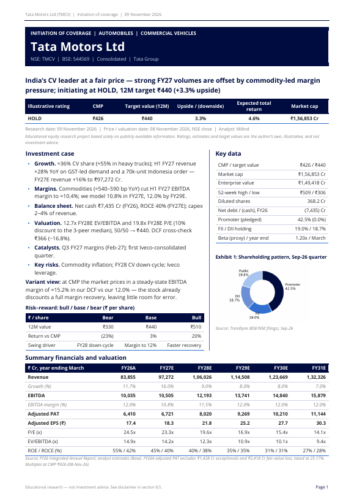
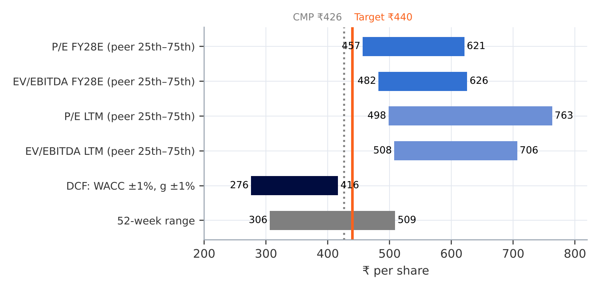
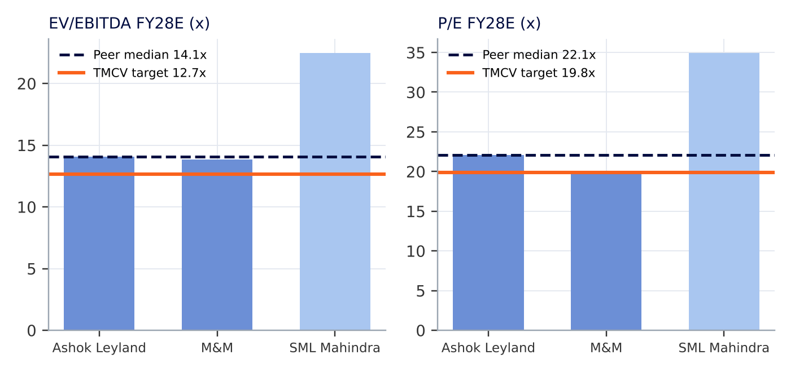
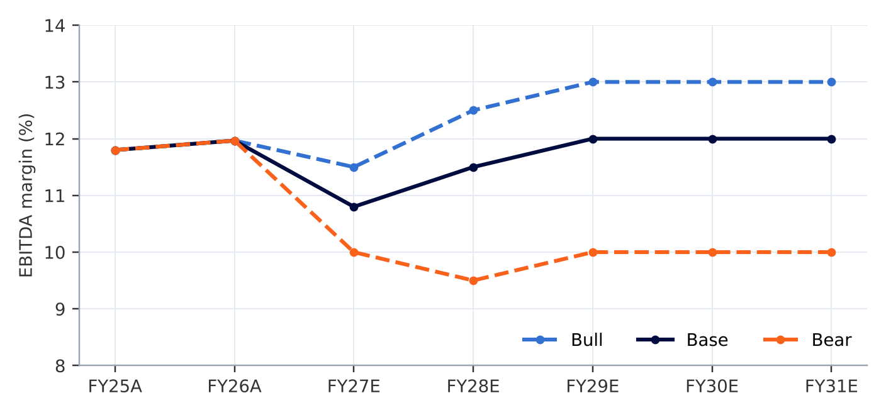

# Tata Motors Ltd (TMCV) — Initiation of Coverage

**Sell-side style equity research on India's largest commercial-vehicle maker — an integrated three-statement model, comps-led valuation with a DCF cross-check, and a 20-page initiation report.**

> Educational project based solely on public information. Ratings and target values are illustrative and are **not investment advice**.

<p align="center"></p>

---

## The call

| Rating | CMP (08-Nov-26) | 12M target | Upside | DCF cross-check | Bull / Bear |
|:--:|:--:|:--:|:--:|:--:|:--:|
| **HOLD** | ₹426 | **₹440** | +3.3% | ₹366 (−17%) | ₹510 / ₹330 |

**Thesis in one line:** TMCV is a high-quality, net-cash market leader enjoying an up-cycle (H1 FY27 revenue +28% YoY), but commodity costs have pushed margins down to ~10.4% — and at ₹426 the market already prices in a full recovery.

**What is priced in (reverse DCF):** the current price requires a steady-state EBITDA margin of **~15.2%** (vs our 12.0% and the FY26 peak of 12.0%), or ~7.3% perpetual growth. That gap is the core of the HOLD.

| Pillar | Evidence | What would prove it wrong |
|---|---|---|
| 1. Volume leadership in an up-cycle | ~36% CV share (~55% in heavy trucks); GST cut 28% → 18%; 70k-unit Indonesia order | Domestic volumes negative YoY for two quarters |
| 2. Margin dip is cyclical, not structural | ~540–590 bp commodity hit; four price hikes; FY26 margin 12.0% | EBITDA margin < 10% for two quarters |
| 3. Capital-light, net-cash compounding | Capex 2–4% of revenue; pre-tax ROCE ~40%; net cash ₹7.4k Cr | Iveco acquisition debt pushed onto the Indian balance sheet |

---

## Valuation snapshot

<p align="center"></p>

- **Primary — trading comparables (FY28E):** 12.7x EV/EBITDA and 19.8x P/E, a 10% discount to the median of Ashok Leyland, M&M and SML Mahindra, weighted 50/50 → **₹440**.
- **Cross-check — FCFF DCF:** WACC 12.6% (Rf 7.12%, ERP 5.2%, β 1.20), g 5.0%, Gordon-growth terminal value → ₹366 (within the ±20% tolerance).
- **Scenarios:** bull ₹510 / base ₹440 / bear ₹330; probability-weighted ≈ ₹430.

| Peer multiples (FY28E) | Margin scenarios |
|:--:|:--:|
|  |  |

---

## What's in this repository

```
├── report/     TMCV_Initiation_of_Coverage.pdf      20-page initiation report
├── model/      TMCV_Equity_Research_Model.xlsx      Fully linked model (Base / Bull / Bear switch)
├── templates/  Template_Equity_Research_Model.xlsx   Blank, reusable model
│               Template_Initiation_of_Coverage.docx  Report template with model-link map
│               Template_Company_Update.docx          Follow-up / results-review template
├── docs/       methodology.md · model-guide.md · data-sources.md
└── assets/     Charts used in this README
```

### The model (Excel, no macros)
**Cover → Outputs → Inputs → Model**, vertically stacked, CFI formatting (blue = inputs, black = formulas, light grey = assumptions).

- **Three-statement model** with working-capital, fixed-asset and debt schedules; balance sheet balances in all 10 years and all three scenarios.
- **Scenario switch** (Best / Base / Worst) driving revenue growth, EBITDA margin and capex, plus an Excel data table summarising all three.
- **Trading comps engine** — market data, LTM and forward multiples, quartile statistics, implied share prices and a target-multiple build with premium / discount and override.
- **DCF cross-check** — stub-period and mid-year discounting, cash rolled to the valuation date, 12-month roll-forward, two live sensitivity grids.
- **12 automated model checks** on the Cover (balance sheet, terminal value share, peer count, DCF tolerance, weights…).

See [`docs/model-guide.md`](docs/model-guide.md) for a sheet-by-sheet map.

---

## Judgement calls worth reading

The interesting part of any model is the assumptions behind it. A few that mattered here (detail in [`docs/methodology.md`](docs/methodology.md)):

1. **Comps primary, DCF as the sanity check** — the sell-side convention; the DCF uses Gordon growth only so the intrinsic check doesn't borrow a market multiple.
2. **Peer selection** — only three listed companies are genuinely comparable after the 2025 demerger left TMCV a pure CV business; passenger-vehicle makers were deliberately excluded.
3. **Standalone peers** — Ashok Leyland and M&M are taken on a standalone basis because their consolidated debt includes lending arms (₹64k Cr and ₹1.3 lakh Cr).
4. **Adjusted earnings** — FY26 profit stripped of ₹1,428 Cr exceptional items and a ₹2,418 Cr fair-value loss, taxed at the 25.17% statutory rate (the 36% reported rate was itself distorted by the one-offs).
5. **ERP without double counting** — Damodaran's India ERP (7.08%) less the 1.87% sovereign default spread already embedded in the INR G-Sec yield.
6. **Proxy beta** — TMCV has roughly one year of trading history, so a regression beta would be unreliable.
7. **History across a demerger** — FY22–FY25 rebuilt from the pre-demerger Tata Motors CV segment; FY26 from TMCV's first annual report.
8. **Iveco excluded** — the October 2026 acquisition is treated as value-neutral and flagged as the key swing factor.

---

## Reusing the templates

1. Copy `Template_Equity_Research_Model.xlsx`, fill the **Inputs** sheet (company data, five years of history, peers, then the light-grey assumption cells).
2. Check the **Cover** — every model check should read *No* (or the flag is explained in the report).
3. Fill `Template_Initiation_of_Coverage.docx` — blue italic text marks placeholders, and green *Model link* notes point to the exact model cells.
4. After results, use `Template_Company_Update.docx` with a dated copy of the model to show old vs new estimates, an EPS bridge and a target-value bridge.

---

## How this was built

Primary sources first — audited annual reports, exchange filings and results — with Screener and broker research as secondary sources and cross-checks (see [`docs/data-sources.md`](docs/data-sources.md)). The model and report were developed with an AI-assisted workflow; every input, assumption and output was reviewed, challenged and validated by the author, and the model was audited for formula consistency, statement ties and an independent DCF recomputation.

## Disclaimer
This is an independent educational project prepared from publicly available information. It is not issued by a SEBI-registered research analyst, is not investment advice, and is not an offer or solicitation to buy or sell any security. Information is believed reliable but is not guaranteed.

## License
Content is shared under [CC BY-NC 4.0](https://creativecommons.org/licenses/by-nc/4.0/) — free to use and adapt for non-commercial purposes with attribution.
